# DIY Welding Positioner Controller

<p align="center">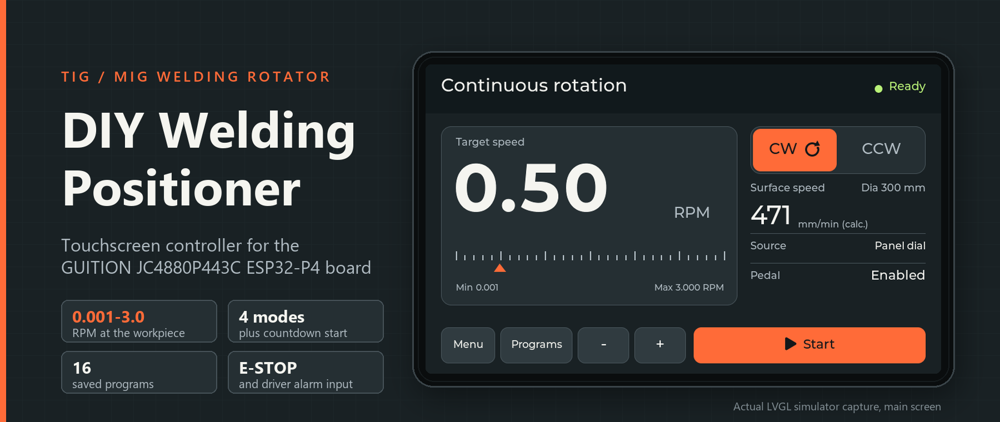</p>

Touchscreen controller for a single-axis TIG/MIG welding rotator, built for the GUITION JC4880P443C 4.3" ESP32-P4 display board.

<p align="center">     </p>

<p align="center">
  <a href="https://github.com/catorendal-a11y/DIY-Welding-Positioner-ESP32-P4/actions/workflows/pio-build.yml"></a>
  <a href="https://github.com/catorendal-a11y/DIY-Welding-Positioner-ESP32-P4/releases/latest"></a>
  <a href="LICENSE"></a>
  <a href="https://github.com/catorendal-a11y/DIY-Welding-Positioner-ESP32-P4/stargazers"></a>
  <a href="docs/HARDWARE_SETUP.md"></a>
</p>

<p align="center">
  <a href="#documentation-and-contributions"></a>
</p>

## Start here

| You want to | Go to |
|---|---|
| 🖥️ **See the UI without hardware** | [Windows simulator](https://github.com/catorendal-a11y/DIY-Welding-Positioner-ESP32-P4/releases/download/v2.4.0/welding-positioner-v2.4.0-simulator-windows-x64.zip): extract all files, open **Start Simulator.cmd**. [Instructions](docs/releases/SIMULATOR.md) |
| ⚡ **Flash a controller** | [Firmware downloads](https://github.com/catorendal-a11y/DIY-Welding-Positioner-ESP32-P4/releases/tag/v2.4.0) and [install firmware](#install-firmware) |
| 🛠️ **Build one** | [Parts](#parts), [wiring](#wiring) and the [builder guide](docs/BUILDER_GUIDE.md) |
| ▶️ **See it run** | [Hardware demo](https://youtu.be/GygLl6XY-TM), which shows an earlier UI |
| 🩺 **Fix a problem** | [Troubleshooting](wiki/Troubleshooting.md) |

## Safety

> [!CAUTION]
> Read this before powering the motor.
>
> - **E-STOP is not a safety relay.** It acts through GPIO34, firmware and the driver ENA input, and it does not disconnect motor power. An open wire can read as healthy. Physical stop time is unmeasured. [Truth table and measurement procedure](docs/estop_timing.md)
> - **E-STOP polarity:** GPIO34 expects **HIGH when healthy, LOW on fault**. A bare NC contact to ground gives the opposite polarity. **ENA HIGH disables** the driver.
> - **ESP32 GPIO is 3.3 V logic.** Never connect 5 V or motor-supply voltage to it.
> - **HF-start TIG:** put the controller, driver and motor PSU in the same grounded metal enclosure. See [TIG HF](#tig-hf).

> [!NOTE]
> **Tested by the owner.** The owner reported on 2026-11-04 that everything works on the assembled v2.3.0 machine, including TIG HF, and that v2.3.1 works on the same machine. Stop time is unmeasured.
>
> **v2.4.0 is checked on screen only.** The owner flashed the v2.4.0 code on 2026-11-10 and confirmed that it boots and that the reworked screens, the fault screen and the screen saver display correctly. Motion, pedal and calibration were not re-tested on it. [Checks to run on your own build](docs/releases/v2.4.0.md#validation-and-hardware-status)

## What it does

<table>
<tr>
<td width="33%" valign="top">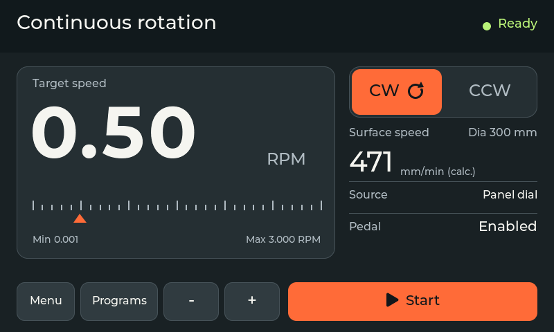<br><b>Continuous</b><br><sub>Set speed with the pot, pedal or -/+ beside the value. One Start/Stop button.</sub></td>
<td width="33%" valign="top">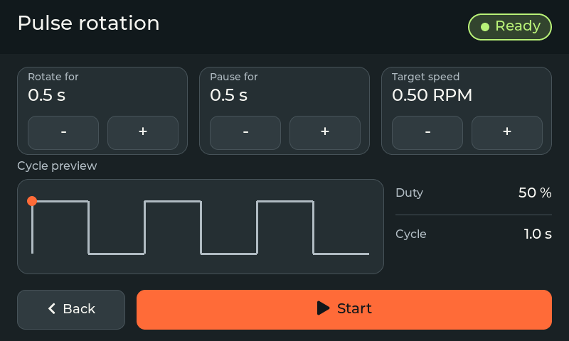<br><b>Pulse</b><br><sub>Rotate, pause, repeat for tack welds. The preview tracks the live cycle.</sub></td>
<td width="33%" valign="top">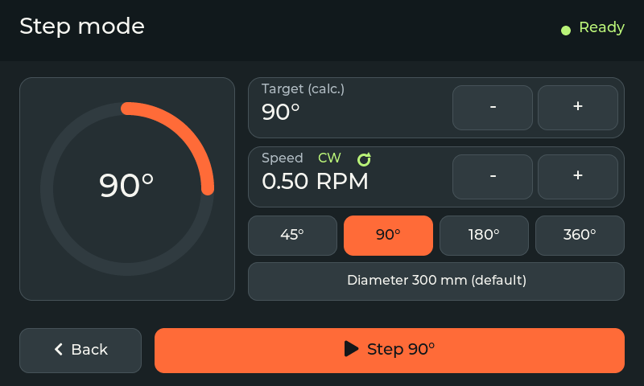<br><b>Step</b><br><sub>Index by an exact angle, 45 to 360 degrees or a custom value.</sub></td>
</tr>
<tr>
<td width="33%" valign="top">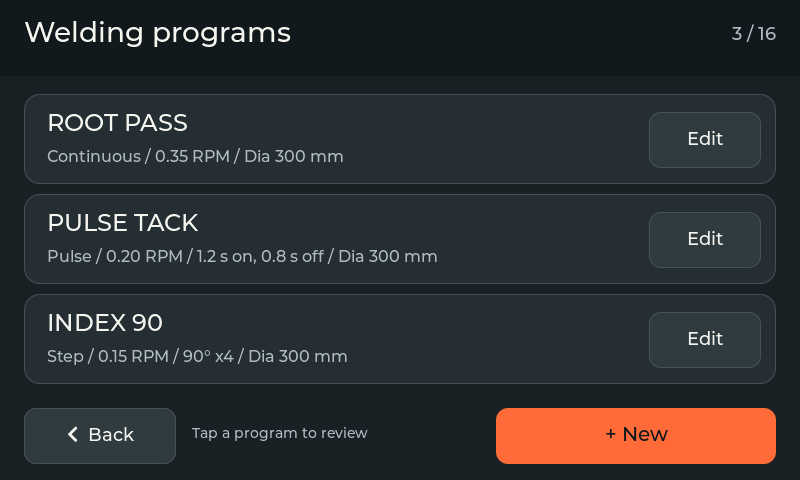<br><b>Programs</b><br><sub>16 saved programs with speed, direction, diameter and mode.</sub></td>
<td width="33%" valign="top">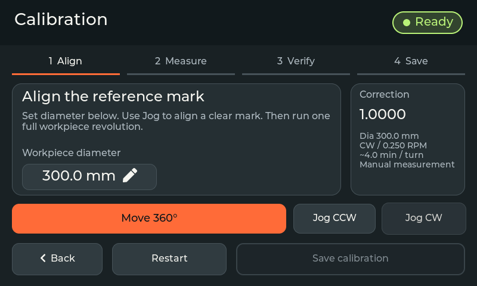<br><b>Calibration</b><br><sub>Align, measure, verify and save against a real measurement.</sub></td>
<td width="33%" valign="top">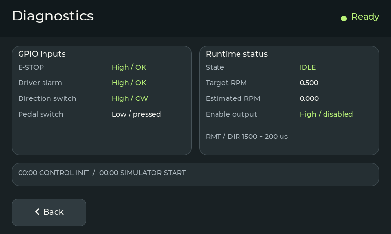<br><b>Diagnostics</b><br><sub>Live inputs, runtime state and the event log.</sub></td>
</tr>
</table>

<sub>All screens are actual LVGL simulator captures at 800 x 480. <a href="docs/images/ui_runtime_v5/overview.png">See every screen</a>.</sub>

| | Feature | Detail |
|:-:|---|---|
| 🔄 | **Continuous, Jog, Pulse, Step** | Optional countdown before starting |
| 🎯 | **0.001-3.0 RPM** | At the workpiece, limited by geometry and calibration. The screen shows the effective range |
| 💾 | **16 saved programs** | Speed, direction, diameter and mode settings |
| 🎛️ | **Pot, switch, pedal** | Panel potentiometer, direction switch and optional foot pedal |
| 🛑 | **Supervision** | E-STOP input, driver alarm, UI and touch watch. The fault screen says what to do next. Resetting a fault never starts rotation |
| 🧭 | **Guided setup** | Setup wizard, calibration, diagnostics, USB-C live mirror and an [idle screen saver](docs/SCREEN_SAVER.md) |

> [!TIP]
> Single axis with no encoder: RPM and progress are calculated, so calibration needs a real measurement.

## New in v2.4.0

| Area | Change |
|---|---|
| Supervision | A heartbeat stamped just after the supervisor read the clock no longer counts as 49 days old. This rare race could stop a weld with HMI STALE or PEDAL INPUT, or drop a held jog |
| Fault screen | Leads with the next action, for example "Release the E-STOP button.", with the cause below. The banner is red while reset is blocked and amber when it is ready |
| Main screen | - and + sit beside the speed value instead of next to Start. Steps are 0.001 RPM below 0.1 RPM |
| Programs | The editors refuse a speed the motor cannot run at the program's diameter. The Available switches are full size |
| Calibration | Named jog directions, a captioned diameter field, and an abandoned diameter no longer stays active |
| Display settings | Back without Save restores brightness, appearance and accent |
| Screen saver | States "Motor stopped" and shows the set speed and direction |
| Status | The header status is a filled pill with larger text on every screen |

<table>
<tr>
<td width="33%" valign="top">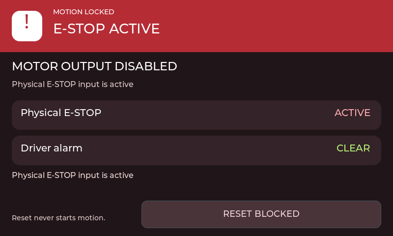<br><b>Fault, reset blocked</b><br><sub>Red banner and the next action.</sub></td>
<td width="33%" valign="top">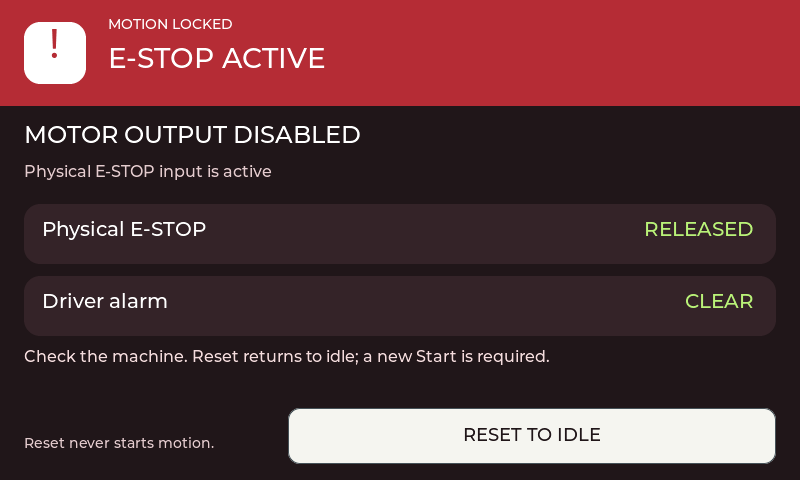<br><b>Fault, ready to reset</b><br><sub>Amber banner once only the reset is missing.</sub></td>
<td width="33%" valign="top">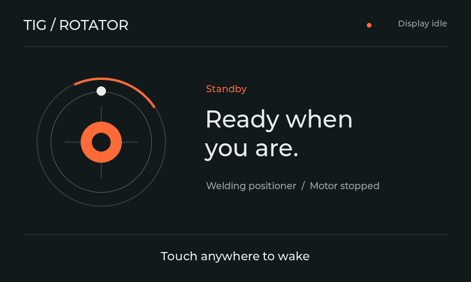<br><b>Screen saver</b><br><sub>Machine state and the set speed.</sub></td>
</tr>
</table>

The owner flashed the v2.4.0 code on 2026-11-10 and confirmed that it boots and that the reworked screens, the fault screen and the screen saver display correctly. Motion, pedal and calibration were not re-tested on it. [Release notes](docs/releases/v2.4.0.md) · [Full list](CHANGELOG.md)

## Parts

| Part | Project hardware |
|---|---|
| Display/controller | GUITION JC4880P443C (ESP32-P4, ST7701S, GT911). Other boards may need different drivers and pins |
| Motor/driver | NEMA 23 stepper, DM542T or a suitable PUL/DIR driver |
| Drivetrain | NMRV030 60:1 worm + 72/40 spur, total 1:108 |
| Motor supply | 24-36 V DC, matched to the driver and motor |
| Controls | Speed potentiometer, direction switch, physical E-STOP |
| Optional | Foot pedal with switch/potentiometer and ADS1115 ADC |
| Enclosure | Grounded metal enclosure for TIG HF use |

Match the driver's current and microstep switches to the touchscreen settings (1/4, 1/8, 1/16 or 1/32). Roller diameter and gear ratio are set in <kbd>Settings</kbd> › <kbd>Motor configuration</kbd>.

<table>
<tr>
<td width="33%" valign="top">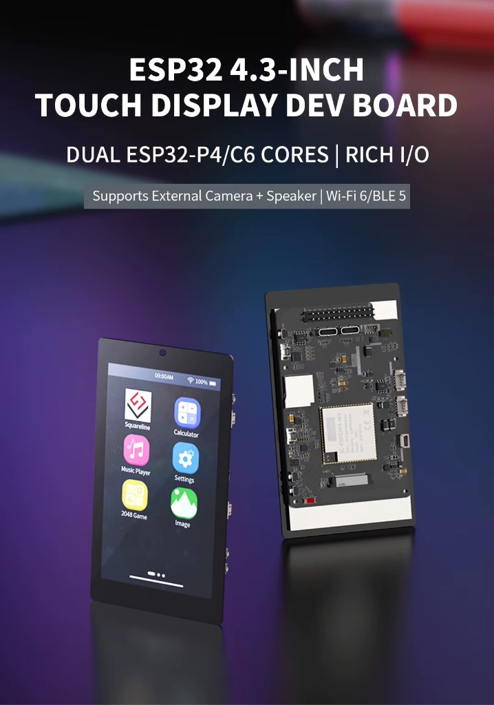<br><b>Controller</b><br><sub>GUITION JC4880P443C, ESP32-P4 + C6</sub></td>
<td width="33%" valign="top">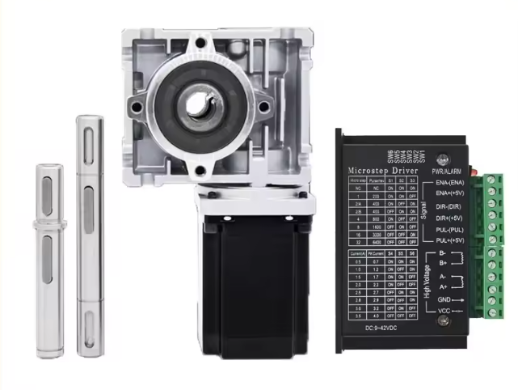<br><b>Drive</b><br><sub>NEMA 23, worm gearbox, PUL/DIR driver</sub></td>
<td width="33%" valign="top">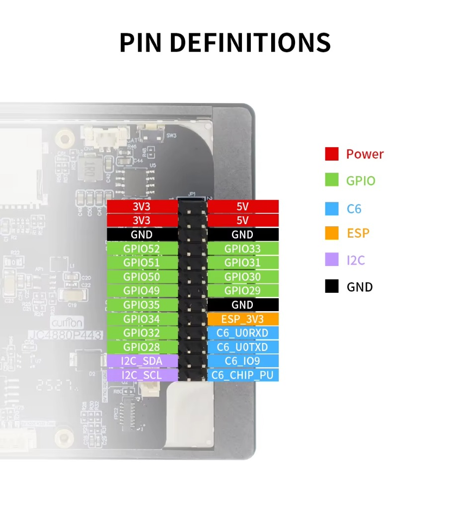<br><b>JP1 header</b><br><sub>2 x 13 pins used for all wiring</sub></td>
</tr>
</table>

## Wiring

[](docs/images/Wiring_diagram.v2.svg)

Dashed blocks specify interface requirements, not verified installed circuitry. The driver routing shown is common-cathode. Confirm the E-STOP interface and ENA polarity on your assembled controller. [Electrical wiring guide](docs/HARDWARE_SETUP.md)

## TIG HF

- [ ] Controller, driver and motor PSU in **one grounded metal enclosure**
- [ ] Enclosure **bonded to protective earth**
- [ ] Motor and power wiring **apart from** GPIO, ADC, I2C, pedal and E-STOP cables
- [ ] **Shielded** external cables, ferrites if interference remains
- [ ] HF-start checks **repeated** after changing firmware, wiring or the enclosure

TIG HF works on the owner's machine with the shared grounded enclosure (v2.3.0, reported 2026-11-04). Stop response has not been measured. [EMI guide](docs/EMI_MITIGATION.md)

## Install firmware

Download a **release**, **debug** or **mirror** bundle and follow [FLASHING.md](docs/releases/FLASHING.md). Application images belong at `0x10000`, never `0x0`. Check the SHA-256 checksums.

To build from source with PlatformIO:

```sh
git clone https://github.com/catorendal-a11y/DIY-Welding-Positioner-ESP32-P4.git
cd DIY-Welding-Positioner-ESP32-P4
git checkout v2.4.0
pio run
```

On Windows, run `pio` from PowerShell: in Git Bash the final image step can fail.

## First run

New installations open the **Setup Wizard**, and valid existing settings are kept. Run it again from <kbd>Settings</kbd> › <kbd>Setup wizard</kbd>.

1. **Motor:** match driver timing and microsteps, set limits, then <kbd>Save & apply</kbd>.
2. **Direction:** press <kbd>Hold CW</kbd> and <kbd>Hold CCW</kbd> and watch the workpiece.
3. **Calibration:** complete <kbd>Move 360°</kbd>, measure, apply, complete <kbd>Verify 360°</kbd>, then save.
4. **Function check:** press and release E-STOP, <kbd>RESET TO IDLE</kbd>, test <kbd>Test start</kbd> and <kbd>Stop</kbd>.

<table>
<tr>
<td width="25%">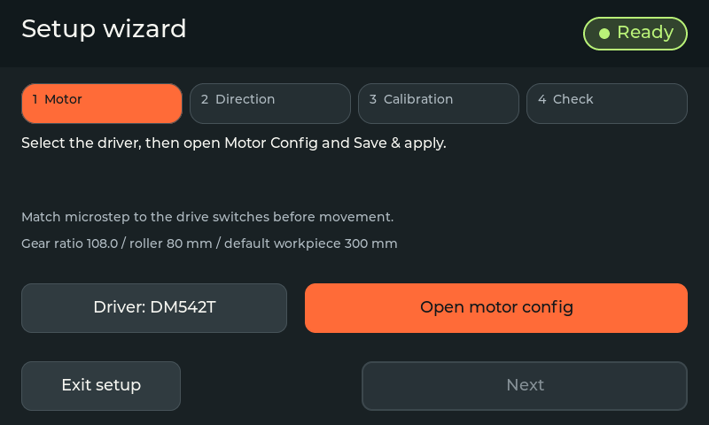<br><sub>1. Motor</sub></td>
<td width="25%">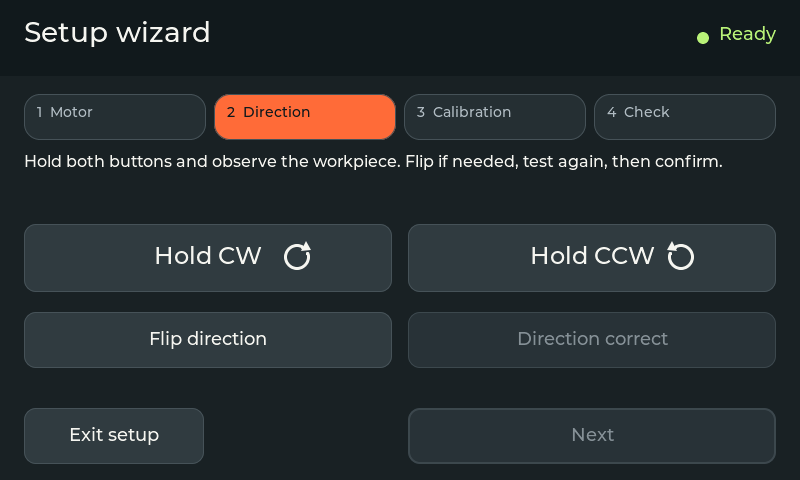<br><sub>2. Direction</sub></td>
<td width="25%">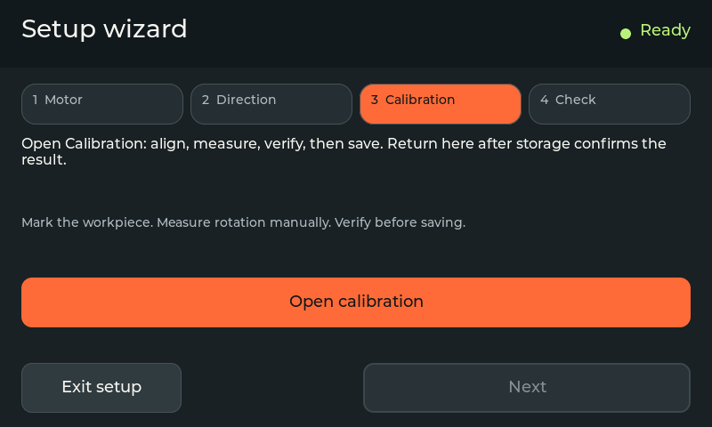<br><sub>3. Calibration</sub></td>
<td width="25%">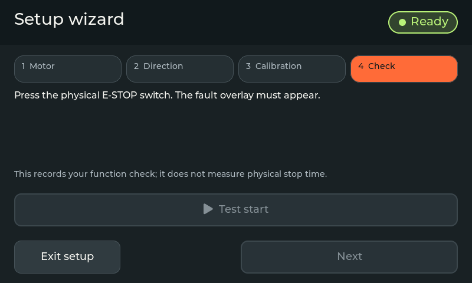<br><sub>4. Function check</sub></td>
</tr>
</table>

The wizard does not measure stop time or certify wiring. [Every wizard screen](docs/SETUP_WIZARD.md) · [Calibration](docs/CALIBRATION_WORKFLOW.md) · [Program editor](docs/PROGRAM_EDITOR.md)

## Validation

<p>     </p>

Every commit runs **492 native tests**, packaging tests, Linux and Windows simulator self-tests, a layout audit and three firmware builds. Release binaries come from the validated master commit. The owner reported v2.3.0 tested on the assembled machine on 2026-11-04. TIG HF works on the owner's machine. The owner reported the v2.3.1 build working on the same machine the same day. The v2.4.0 code was flashed on 2026-11-10 and its screens were checked; motion was not re-tested on it. Stop time has not been measured. [v2.4.0 status](docs/releases/v2.4.0.md#validation-and-hardware-status) · [Changelog](CHANGELOG.md)

## Documentation and contributions

| Need | Guide |
|---|---|
| Full reference | [Builder guide](docs/BUILDER_GUIDE.md) |
| Wiring and driver setup | [Hardware](docs/HARDWARE_SETUP.md) |
| Installation and first run | [Flashing](docs/releases/FLASHING.md) · [Getting started](wiki/Getting-Started.md) |
| Design | [Control architecture](docs/CONTROL_SETUP_IMPLEMENTATION.md) · [Process flow](PROCESS_ANALYSIS.md) · [USB mirror](simulator/README.md#usb-c-live-mirror) |
| Dependencies | [Library report](docs/DEPENDENCY_UPGRADE_2026-10-02.md) · [FastAccelStepper audit](docs/FASTACCELSTEPPER_1_4_REAUDIT.md) |
| Contribute or report | [Contributing](CONTRIBUTING.md) · [Issues](https://github.com/catorendal-a11y/DIY-Welding-Positioner-ESP32-P4/issues) |

Built one? Share your photos, driver and motor configuration and firmware version in an issue.

**MIT licensed.** See [LICENSE](LICENSE). Dependencies and fonts keep their own notices.
