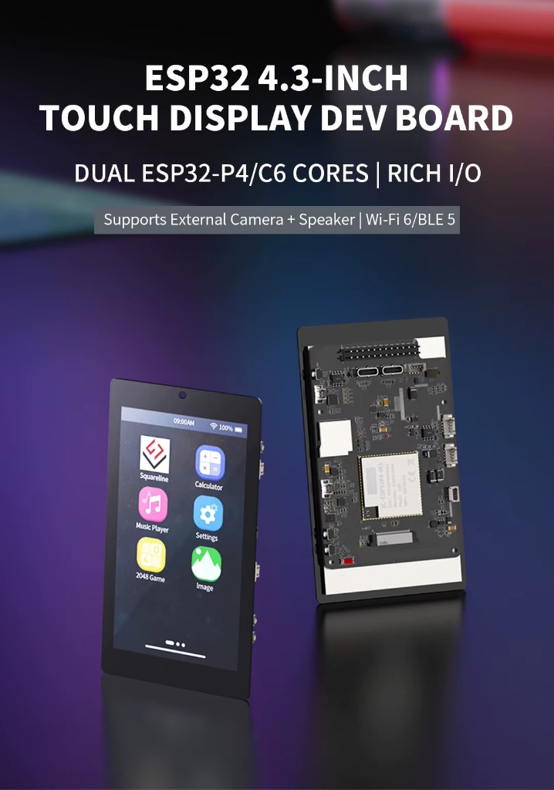
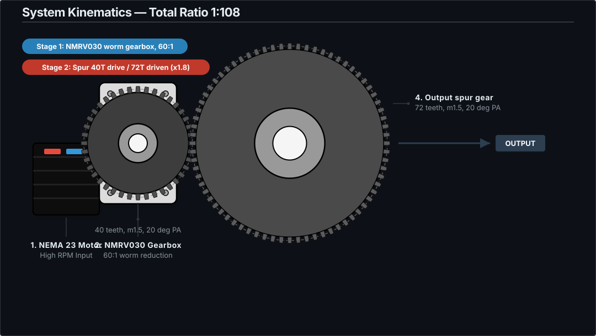
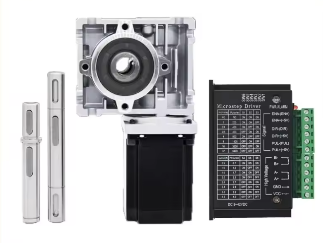
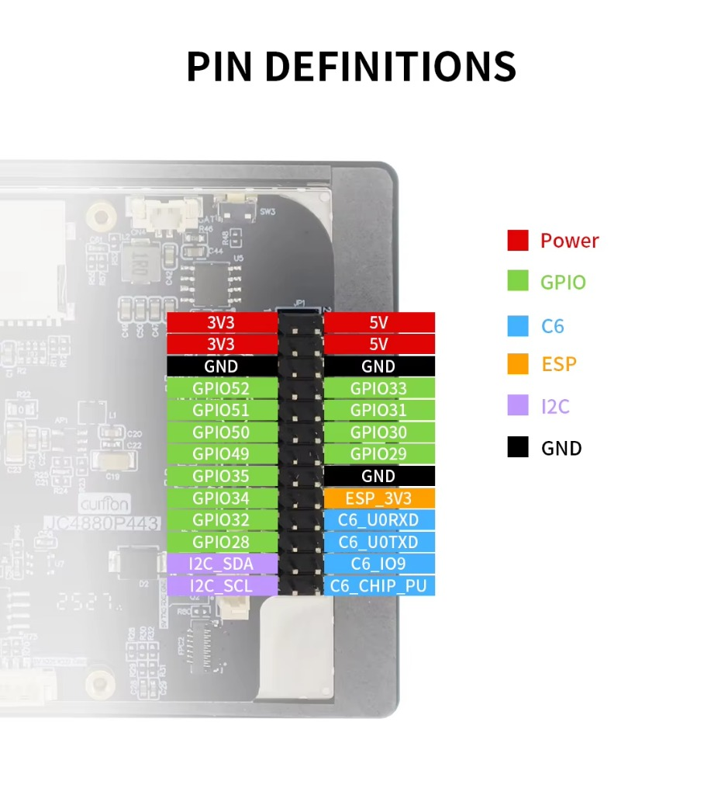
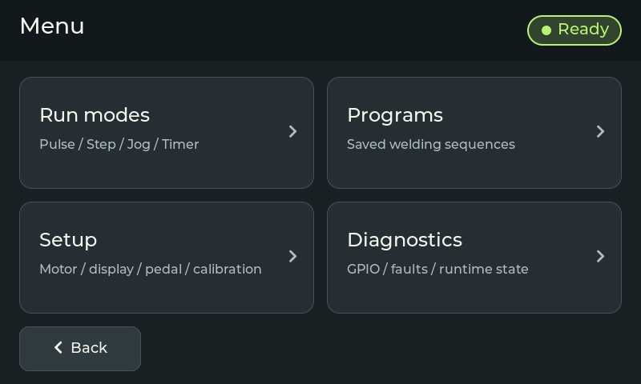
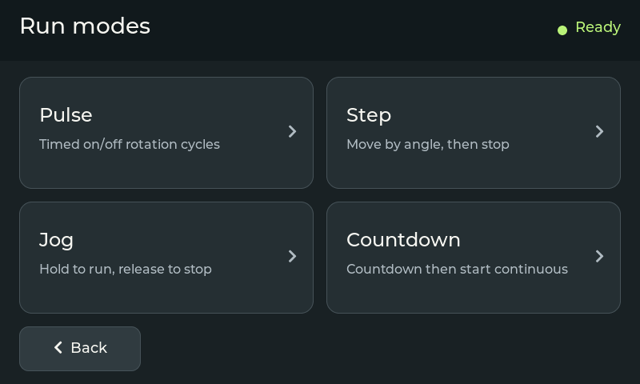

# Builder Guide

Build, wire, flash and commission the welding positioner, in order. For a short overview, see the [README](../README.md).

## Contents

1. [Parts and specs](#parts-and-specs)
2. [Wiring](#wiring)
3. [Build and flash](#build-and-flash)
4. [First run](#first-run)
5. [Operating](#operating)
6. [Configuration](#configuration)
7. [Safety](#safety)
8. [More](#more)

---

## Parts and specs

<div align="center">
  
</div>

### Bill of materials

| Component | Model / specs | Qty |
|:---|:---|:---:|
| **MCU board** | GUITION JC4880P443C (800x480, ESP32-P4 + ESP32-C6, MIPI-DSI) | 1 |
| **Stepper driver** | PUL/DIR or DM542T | 1 |
| **Stepper motor** | NEMA 23 (3 Nm torque) | 1 |
| **Gearbox** | NMRV030 + spur (**1:108** total) | 1 |
| **Power supply** | 24-36 V DC, 5 A+ (**36 V optimal**, **24 V** works) | 1 |
| **Speed pot** | 10k potentiometer | 1 |
| **Direction switch** | SPDT toggle switch | 1 |
| **E-STOP** | NC mushroom button | 1 |
| **Foot pedal** | Analog pot + momentary switch | 1 |
| **ADS1115** | 16-bit I2C ADC (0x48-0x4B) for the pedal pot | 1 |

### Performance specs

| Parameter | Value |
|:---|:---|
| **Output RPM range** | **0.001 - 3.0 RPM** configured envelope, further limited by geometry, calibration and the 20 Hz step-rate floor. The UI shows the effective minimum. Motor configuration can lower the maximum in NVS |
| **Gear ratio** | **1 : 108** default (NMRV030 60:1 x spur 72/40), set in Motor configuration |
| **Roller / workpiece defaults** | `D_RULLE` 80 mm roller (set in Motor configuration), `D_EMNE` 300 mm reference workpiece OD. Used in `rpmToStepHz()` and `angleToSteps()` |
| **Per-diameter cap** | Workpiece RPM is limited by `MAX_STEP_HZ` (200 kHz) and `MOTOR_RPM_LIMIT` (1500 RPM). Programs above the cap are blocked at start |
| **Microstepping** | 1/4, 1/8, 1/16 (default), 1/32. Set in Motor configuration, stored in NVS |
| **Motor torque** | 3.0 Nm (NEMA 23) |
| **Control resolution** | Sub-milli-RPM. Speed is computed in milli-Hz and applied with `setSpeedInMilliHz()` + `applySpeedAcceleration()` |
| **Display** | 800 x 480 landscape, LVGL 9.6.0, RGB565, 2-lane MIPI-DSI |
| **Flash** | 16 MB. Two `0x640000`-byte app slots, `0x360000`-byte SPIFFS area, NVS/OTA metadata and coredump. See [flashing guide](releases/FLASHING.md) |
| **RAM** | About 36 KB static RAM in the release build, plus 150 KiB of runtime SRAM for LVGL strips. Task stacks and other heap are extra. MIPI-DSI framebuffers stay in PSRAM. See [rendering details](LVGL_9_6_UI_IMPROVEMENTS.md#partial-sram-rendering-october-2026) |

### Gear system

<div align="center">
  
  <br>
  
  <br><sub>NEMA 23 stepper with worm gear reducer and PUL/DIR driver</sub>
</div>

---

## Wiring

<div align="center">
  
</div>

> [!WARNING]
> **Input contract:** firmware expects `GPIO34` `HIGH` when healthy and `LOW` when faulted. The diagram shows the NC button behind a required input interface, because a bare NC contact to GND gives the opposite logic.

Dashed boxes are interface requirements, not verified installed circuitry. The common-cathode driver routing is the original. Confirm signal levels and **ENA HIGH = disabled** on your driver. Check the assembled interface against [Hardware Setup](HARDWARE_SETUP.md).

> [!NOTE]
> Revision 2.6 corrected DIP notes, input annotations and RPM limits and removed the unmeasured 0.5 ms claim. Revision 2.8 only improves legibility. Every connection is unchanged.

### Pinout

<div align="center">
  
</div>

| ESP32-P4 pin | Function | Notes |
|:---|:---|:---|
| `GPIO50` | STEP (output) | RMT pulse to driver PUL+ |
| `GPIO51` | DIR (output) | Direction to driver DIR+ |
| `GPIO52` | ENABLE (output) | Active LOW to driver ENA |
| `GPIO49` | POT (ADC input) | 10k speed pot (ADC2_CH0, 11 dB attenuation, ref range 0-3315) |
| `GPIO29` | DIR SWITCH (input) | CW/CCW toggle, `INPUT_PULLUP` (LOW = CCW, HIGH = CW) |
| `GPIO34` | E-STOP (input, ISR) | HIGH = healthy, LOW = fault, `FALLING` interrupt. Verify interface polarity and cable-break response |
| `GPIO33` | PEDAL SW (input) | Foot pedal switch, `INPUT_PULLUP`, active LOW |
| `GPIO32` | DRIVER ALM (input) | DM542T alarm, `INPUT_PULLUP`, open-drain active LOW |
| `GPIO7` / `GPIO8` | Touch I2C | GT911 @ 0x5D and ADS1115 pedal ADC @ 0x48-0x4B when `ENABLE_ADS1115_PEDAL=1` |
| `GPIO14-19`, `28`, `54` | Board / C6 routing | May route to the on-board ESP32-C6. Firmware uses only the ESP32-P4 side. Do not repurpose without the vendor schematic |

### Safety-critical wiring

> [!IMPORTANT]
> Verify these signals with a meter before enabling motor power.

| Signal | Required safe behavior |
|:---|:---|
| ENA / `GPIO52` | HIGH = driver disabled, LOW = driver enabled |
| E-STOP / `GPIO34` | Released = HIGH, pressed or fault = LOW |
| DM542T ALM / `GPIO32` | HIGH = driver OK, LOW = alarm or fault |
| STEP / `GPIO50` | Pulse output only. Do not share with other hardware |
| DIR / `GPIO51` | Direction output to driver |
| Grounds | ESP32 logic ground, driver signal ground and pedal/ADS1115 ground must be common |
| Enclosure | ESP32-P4 screen, driver and motor PSU inside one grounded metal enclosure for TIG HF |

> [!CAUTION]
> ESP32 GPIO is **3.3 V logic**. Never connect 5 V or motor-supply voltage to it. Never feed motor `VM` to the opto inputs (PUL/DIR/ENA). Driver current switches, DM542T DIP tables and ADS1115 wiring are in [Hardware Setup](HARDWARE_SETUP.md).

> [!CAUTION]
> The firmware never intentionally enables the motor while E-STOP is active. If the motor moves at boot or while ENA is HIGH, treat it as a wiring or driver configuration fault before continuing.

At motion start, firmware checks the safety inputs before taking the stepper mutex and again right after ENA goes LOW. If E-STOP or DM542T ALM becomes active in that last window, ENA is driven HIGH again before a run or move command is sent.

---

## Build and flash

Default environment: `esp32p4-release`. Build output goes to `.pio/build-fw` to avoid Windows file-lock problems. No LittleFS upload is needed, because settings and presets use NVS.

| Task | Command |
|:---|:---|
| Release build | `pio run` |
| Debug build (verbose serial log) | `pio run -e esp32p4-debug` |
| USB-C mirror build | `pio run -e esp32p4-mirror` |
| Flash release firmware | `pio run --target upload` |
| Flash debug firmware | `pio run --target upload -e esp32p4-debug` |
| Serial monitor | `pio device monitor` |
| Native tests | `pio test -e native -e native-control -e native-speed -e native-storage -e native-safety -e native-control-storage` |
| Packaging tests | `python -m unittest discover -s test/tooling` |
| Static analysis | `pio check -e static-analysis --severity=high --severity=medium` |
| On-device tests | `pio test -e esp32p4-test` |

Serial ports are detected automatically. Use `pio device list`, then `--upload-port COM3` (example) to override. Native tests need no hardware.

> [!IMPORTANT]
> Keep the motor PSU off until logic power, E-STOP, ENA, STEP, DIR and driver settings are verified.

- **Prebuilt firmware:** see [FLASHING.md](releases/FLASHING.md). Application images go at `0x10000`, never zero.
- **Simulator and USB-C mirror:** see the [simulator README](../simulator/README.md). The simulator controls no hardware. The mirror needs the `esp32p4-mirror` build.
- **Pinned dependencies:** PlatformIO Core `6.2.0`, pioarduino `55.03.312-1` (Arduino `3.3.12` / ESP-IDF `5.5.5`), LVGL `9.6.0`, FastAccelStepper `1.4.0` at commit `f24a659`, ArduinoJson `7.4.3`, Unity `2.7.0`. FastAccelStepper uses the upstream Git commit because the registry package with the same version lacks the corrected RMT implementation. Older v2.1.0 binaries keep their original dependencies. See the [dependency report](DEPENDENCY_UPGRADE_2026-10-02.md).

---

## First run

New installations open the **Setup Wizard**. Valid existing settings are kept. Run it again from <kbd>Settings</kbd> › <kbd>Setup wizard</kbd>.

1. **Motor:** match driver timing and microsteps, set limits, then <kbd>Save & apply</kbd>.
2. **Direction:** hold <kbd>Hold CW</kbd> and <kbd>Hold CCW</kbd> and watch the workpiece.
3. **Calibration:** <kbd>Move 360°</kbd>, measure, <kbd>Apply measurement</kbd>, <kbd>Verify 360°</kbd>, then <kbd>Save calibration</kbd>.
4. **Function check:** press and release E-STOP, <kbd>RESET TO IDLE</kbd>, <kbd>Test start</kbd>, <kbd>Stop</kbd>, <kbd>Next</kbd>, <kbd>Finish</kbd>.

> [!NOTE]
> The wizard does not start motion on completion and does not measure stop time. Setup is confirmed only after its save succeeds. Calibration saves only within 360 ± 0.5 degrees, and STOP cancels a measurement.

Details: [Setup Wizard](SETUP_WIZARD.md) · [Calibration workflow](CALIBRATION_WORKFLOW.md)

---

## Operating

### Welding modes

| Mode | Description |
|:---|:---|
| **Continuous** | Runs at set RPM. Press <kbd>Start</kbd>, then <kbd>Stop</kbd> |
| **Jog** | Touch-and-hold rotation for manual positioning |
| **Pulse** | Rotate ON ms, pause OFF ms, repeat. For tack welding. Direction is latched at start |
| **Step** | Rotate an exact angle (e.g. 90 deg), then stop. Holding torque stays on during the dwell |
| **Countdown** | Not a separate mode. A visual 3-2-1 countdown before rotation starts (configurable 1-10 s) |

### Operator workflow

1. **Power** the ESP32-P4 logic first. The firmware boots with ENA disabled.
2. **Check** that the main screen appears, touch responds and E-STOP is released.
3. **Match** driver current and microstep DIP switches to <kbd>Settings</kbd> › <kbd>Motor configuration</kbd>.
4. **Switch on** the motor supply after STEP/DIR/ENA and E-STOP wiring are checked.
5. **Set** RPM with the main pot or <kbd>+</kbd> / <kbd>−</kbd> beside the speed value, then press <kbd>Start</kbd>.
6. **Pick a mode** from <kbd>Menu</kbd> › <kbd>Run modes</kbd>: Jog, Pulse, Step or Countdown.
7. **Hit** E-STOP first when motion looks unsafe.

> [!NOTE]
> Speed and direction changes are blocked during motion. The physical direction switch keeps priority when enabled. The fault overlay says what to do next. It resets only after the fault is cleared, when its banner turns from red to amber, and reset never starts rotation.

<table>
<tr>
<td align="center"><br><sub>Menu</sub></td>
<td align="center"><br><sub>Run modes</sub></td>
</tr>
</table>

- **Program editor:** <kbd>Programs</kbd> › <kbd>+ New</kbd>. See [Program editor](PROGRAM_EDITOR.md). Up to 16 programs.
- **Display settings:** brightness, appearance and accent are previewed at once. <kbd>Save</kbd> keeps them; <kbd>Back</kbd> without Save restores the saved values.
- **Screen saver:** <kbd>Settings</kbd> › <kbd>Display settings</kbd> › <kbd>Screen saver after</kbd>. See [Screen saver](SCREEN_SAVER.md).
- **USB-C live mirror:** flash `esp32p4-mirror`, then arm <kbd>Settings</kbd> › <kbd>Display settings</kbd> › <kbd>USB remote control</kbd> on the device. E-STOP and driver faults still override all UI input. See the [simulator README](../simulator/README.md#usb-c-live-mirror).

---

## Configuration

Hardware parameters live in `src/config.h`.

| Define | Value | Meaning |
|:---|:---|:---|
| `MIN_RPM` | `0.001f` | Minimum workpiece RPM (pot / clamp floor) |
| `MAX_RPM` | `3.0f` | Absolute ceiling for the Max RPM setting and firmware clamp |
| `GEAR_RATIO` | `60 * 72 / 40` = 108 | Default. Set in Motor configuration |
| `D_EMNE` | `0.300f` m | Reference workpiece diameter for kinematics |
| `D_RULLE` | `0.080f` m | Default roller diameter. Set in Motor configuration |
| `MAX_STEP_HZ` | `200000.0f` | Pulse ceiling behind the per-diameter RPM cap |
| `MOTOR_RPM_LIMIT` | `1500.0f` | Chosen motor limit, not a measured value |
| `START_SPEED` | `20` Hz | Operational minimum. Lower RPM requests are rejected |

Acceleration and microstep are stored in NVS (Motor configuration). Defaults: 7500 steps/s^2 at 1/16, microstep 1/16. Settings can also be changed on screen under <kbd>Settings</kbd> › <kbd>Motor configuration</kbd>.

### Persistence (NVS)

Settings and presets use the Arduino `Preferences` API (`src/storage/storage.cpp`).

| Item | Namespace | Key | Format |
|:---|:---|:---|:---|
| System settings | `wrot` | `cfg` | JSON object (ArduinoJson, binary blob via `putBytes`) |
| Program presets (max 16) | `wrot` | `prs` | JSON array of preset objects |

| Behavior | Detail |
|:---|:---|
| Migration | `storage_init()` copies legacy LittleFS `/settings.json` and `/presets.json` into NVS once, if `cfg` / `prs` are empty |
| Load order | Settings load before presets. Preset RPM is limited to the firmware range (`MIN_RPM` to `MAX_RPM`), not to the saved **Max RPM**, so lowering Max RPM never rewrites a program; a program above the current limit is blocked at start. Invalid microstep values fall back to `1/16` |
| Partition | Confirm the NVS partition is in your partition table if nothing persists after a flash erase (typical size 24 KB / `0x6000` in shipped configs) |
| Display fields | The settings blob holds `color_scheme` (`0` dark, `1` light), `accent_color` (0-7), brightness and dim timeout. See `SystemSettings` / `storage.cpp` |
| Save timing | `storageTask` on Core 1 debounces ~500 ms after preset changes and ~1 s after settings changes. UI code never writes flash directly |
| Save conditions | Writes run only in IDLE or ESTOP. A start waits for a save in progress |
| Write failures | Failed saves stay pending and retry with backoff. The UI shows pending or error state. The inactivity timeout uses a 16-bit field, so 300 seconds persists correctly |
| Flash cache | NVS commits briefly disable the flash cache, and the prebuilt framework has no IRAM-safe RMT/GPIO ISRs, so writes wait for rest. `g_flashWriting` lets the UI avoid glitches |

Invalid saved data boots to a visible **STORAGE** fault with motion disabled and the data untouched. Reflash a matching build to keep the data, or use <kbd>Hold 3 s to erase data</kbd> on the fault overlay.

> [!WARNING]
> <kbd>Hold 3 s to erase data</kbd> erases the saved data and restarts. You then reconfigure the machine.

Fatal init errors are logged on the serial monitor via `LOG_E`, for example `FATAL: motor: FastAccelStepper init — motion disabled`. The controller then stays halted with ENA disabled instead of rebooting.

Problems? See [Troubleshooting](../wiki/Troubleshooting.md), including [fault names](../wiki/Troubleshooting.md#fault-names). The task and state-machine design is in [Architecture](../wiki/Architecture.md).

---

## Safety

> [!CAUTION]
> This controller drives industrial stepper motors. Follow all safety precautions.

> [!WARNING]
> **E-STOP is not a safety relay.** It acts through the MCU and the driver ENA input and does not disconnect motor power. An open E-STOP wire reads as healthy. Physical stop time is **unmeasured**. Procedure: [estop_timing.md](estop_timing.md).

| Hazard | Precaution |
|:---|:---|
| **E-STOP** | `GPIO34` LOW triggers ENA HIGH and a latched fault. Verify electrical polarity and measure physical stop latency |
| **Dim + fault** | If the panel has dimmed on timeout, E-STOP still wakes the backlight so the red overlay is visible (`g_wakePending` / `dim_reset_activity()`) |
| **Power sequencing** | Never power the motor without the driver connected to the coils |
| **Motor coils** | Never connect or disconnect coils while the driver is powered |
| **Voltage** | Verify motor PSU (24 V or 36 V) before connecting. **36 V** is optimal if driver and wiring allow it |
| **TIG HF noise** | Use a grounded metal enclosure around ESP32-P4 screen, driver and PSU before welding |

### TIG HF requirement

> [!IMPORTANT]
> A shared grounded metal enclosure for the ESP32-P4 screen, stepper driver and motor PSU is a hard requirement for HF-start TIG. Bond it to protective earth, separate motor wiring from signal wiring, and use shielded cables and ferrites if interference remains. Full checklist: [EMI mitigation](EMI_MITIGATION.md) and [EMI test notes](emi_test.md).

Real TIG welding validation was completed with the electronics in a shared grounded metal enclosure. The controller, motor logic, UI and E-STOP behavior worked during welding.

> [!WARNING]
> Do not judge TIG reliability from an open-bench test. Bench wiring is acceptable for firmware and motion checks only.

### First bench test checklist

- [ ] Display boots successfully
- [ ] Touch input responds correctly
- [ ] Motor rotates at target RPM
- [ ] E-STOP disables the driver. Measure physical stop response and verify cable-break behavior
- [ ] Direction switch toggles CW/CCW
- [ ] Potentiometer controls speed
- [ ] All 4 rotation modes and the countdown tested
- [ ] Program preset save/load verified
- [ ] Foot pedal starts/stops motor (if connected)
- [ ] TIG HF start tested with controller electronics inside the grounded metal enclosure
- [ ] Let the display dim, then trigger E-STOP. Backlight returns and overlay is readable

### Known limitations

- Single-axis control only.
- An open E-STOP wire reads as healthy. E-STOP acts through the MCU and driver ENA input and does not disconnect motor power.
- A floating pot wiper is not detected, and the analog pedal is not jump-checked.
- No closed-loop tachometer feedback. RPM is commanded from kinematics, calibration and step timing.
- Basic PUL/DIR drivers have no anti-resonance DSP. DM542T is recommended for smoother low-speed and higher-RPM work.
- `GPIO14-19`, `28` and `54` may be tied to the on-board ESP32-C6. Confirm the board pinout before using them.

### Validation status

> [!NOTE]
> Physical results below are owner-reported. Stop time has not been measured.

| Local check | Result |
|:---|:---|
| Native suites | 492 / 492 passed (native/control/speed/storage/safety suites) |
| Packaging tests | 10 / 10 passed |
| LVGL self-test | Passed: navigation, program edits, RPM adjustment, fault reset, full setup/calibration workflows, save failure/retry and stale control |
| Firmware builds | Release, debug and mirror passed |
| Device upload | Functional pre-release commit 673e078 uploaded to COM3 and flash data verified on 2026-10-03. On 2026-10-05 the pedal-fix build (c4ea129) was flashed and hash-verified. The boot scan detects the ADS1115 at 0x48 and the owner confirms the pedal (GPIO33 + analog speed) works. No quantitative stop-time measurements were supplied |
| Physical motor/safety testing | The owner reported v2.3.0 tested on the assembled machine on 2026-11-04, including TIG HF. The owner reported the v2.3.1 build working on the same machine the same day. Stop time has not been measured. The upload records above are v2.2.x builds |

[Dependency validation logs](validation/2026-10-02/dependencies) and [program editor validation](validation/2026-10-03/program-editor/README.md) record local runs. Native tests include direct production-policy tests, but older tests also model behavior separately, and simulator hardware is stubbed. CI runs native and packaging tests, three firmware variants, and SDL self-test and layout checks. Release status: [v2.3.1 notes](releases/v2.3.1.md) · [v2.2.0 notes](releases/v2.2.0.md) · [Logic review](archive/CODE_LOGIC_REVIEW_2026-10-03.md).

---

## More

### Documentation map

| Document | Use it for |
|:---|:---|
| [HARDWARE_SETUP.md](HARDWARE_SETUP.md) | Driver wiring, DM542T checklist, ADS1115 wiring, reserved pins |
| [EMI_MITIGATION.md](EMI_MITIGATION.md) | Required TIG HF enclosure, shielding, grounding, ferrites, RC and TVS guidance |
| [emi_test.md](emi_test.md) | EMI test notes |
| [SAFETY_SYSTEM.md](SAFETY_SYSTEM.md) | E-STOP behavior, watchdog model, safety assumptions |
| [PROJECT_IMPLEMENTATION.md](PROJECT_IMPLEMENTATION.md) | RTOS architecture, storage, display pipeline, known workarounds |
| [INSTRUCTABLES.md](INSTRUCTABLES.md) | Builder-friendly article content and assembly flow |
| [PROGRAM_EDITOR.md](PROGRAM_EDITOR.md) | New Program workflow and screenshots |
| [CALIBRATION_WORKFLOW.md](CALIBRATION_WORKFLOW.md) | Guided measurement, verification and screenshots |
| [SETUP_WIZARD.md](SETUP_WIZARD.md) | Guided setup, physical switch checks and screenshots |
| [SCREEN_SAVER.md](SCREEN_SAVER.md) | Idle screen saver behavior and captures |
| [CONTROL_SETUP_IMPLEMENTATION.md](CONTROL_SETUP_IMPLEMENTATION.md) | Motion ownership, snapshot freshness, compatibility and validation |
| [UI_V5_DEPLOYMENT.md](UI_V5_DEPLOYMENT.md) | V5 UI implementation, screenshots and device upload evidence |
| UI design mockups | [V5 SVG proposals](images/ui_mockup_v5/all_screens.svg) · [design bundle](images/ui_mockup_v5.zip) · [readability review](images/ui_mockup_v5/READABILITY_REVIEW.md) · [previous UI map](images/ui_screens.svg) |
| [IMPROVEMENTS_2026-10-01.md](IMPROVEMENTS_2026-10-01.md) | Code improvements, checks and remaining bench work |
| [estop_timing.md](estop_timing.md) | Physical E-STOP measurement procedure |
| [releases/FLASHING.md](releases/FLASHING.md) · [releases/SIMULATOR.md](releases/SIMULATOR.md) | Flashing and the portable Windows simulator |
| [CHANGELOG.md](../CHANGELOG.md) | Release history |
| [CONTRIBUTING.md](../CONTRIBUTING.md) | Fork, build, test and pull-request workflow |
| [CODE_OF_CONDUCT.md](../CODE_OF_CONDUCT.md) | Contributor Covenant |
| [GitHub Wiki](https://github.com/catorendal-a11y/DIY-Welding-Positioner-ESP32-P4/wiki) | Public builder guide: getting started, hardware, troubleshooting, architecture, roadmap |
| [Getting-Started](../wiki/Getting-Started.md) · [Troubleshooting](../wiki/Troubleshooting.md) · [Architecture](../wiki/Architecture.md) · [Roadmap](../wiki/Roadmap.md) | Wiki pages in this repo |
| [test/README.md](../test/README.md) | Native and on-device test entry points |

### Project structure

```
src/
  main.cpp          Setup, FreeRTOS tasks (Core 0 / Core 1 pinning)
  config.h          Pinouts, gear ratio, RPM limits, log macros
  app_state.h/cpp   Cross-core std::atomic flags (g_estopPending, g_uiResetPending,
                    g_wakePending, g_flashWriting, g_screenRedraw, g_dir_switch_cache,
                    motorConfigApplyPending) + fatal_halt()
  event_log.h/cpp   RAM ring buffer for Diagnostics events
  control/          State machine, program_executor, modes/ (continuous, jog, pulse, step_mode)
  motor/            motor, speed (pot, pedal, direction), acceleration, microstep, calibration
  safety/           safety.cpp: E-STOP ISR, boot de-floating, UI reset, supervision
  storage/          storage.cpp: NVS settings and presets, LittleFS migration
  ui/               display, lvgl_hal, theme, screens (23 registered ScreenId roots + E-STOP overlay)
test/               test_logic/ (native Unity), test_device_*/ (ESP32-P4 required)
simulator/          Windows SDL2 LVGL simulator and UI smoke test
```

### License

MIT, see [LICENSE](../LICENSE). Dependencies keep their own licenses, including the [SIL OFL license for the Montserrat numeric font](../src/ui/fonts/OFL-Montserrat.txt).
