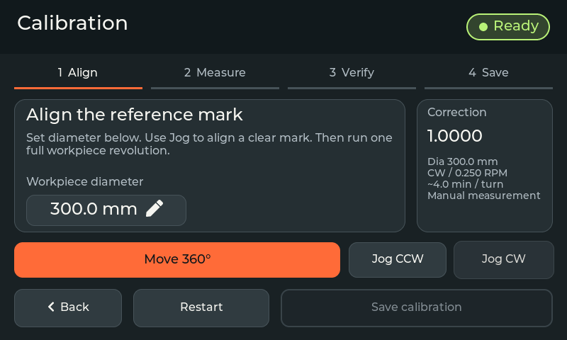
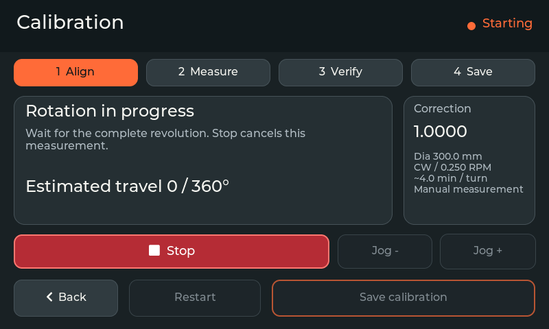
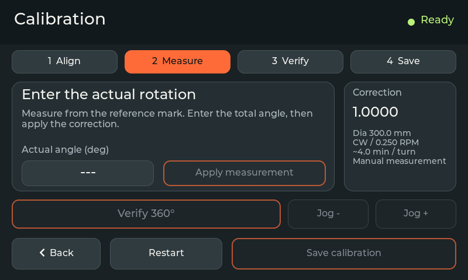
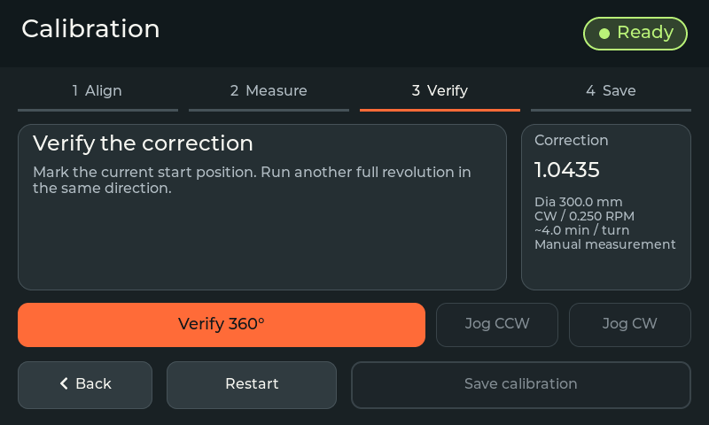
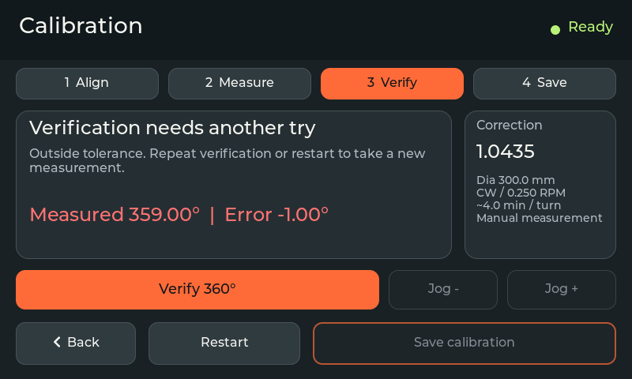
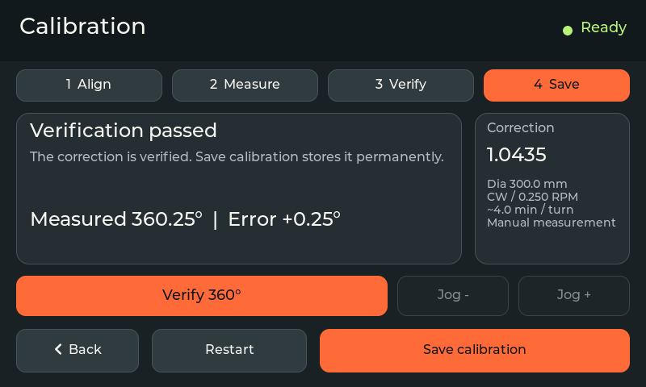
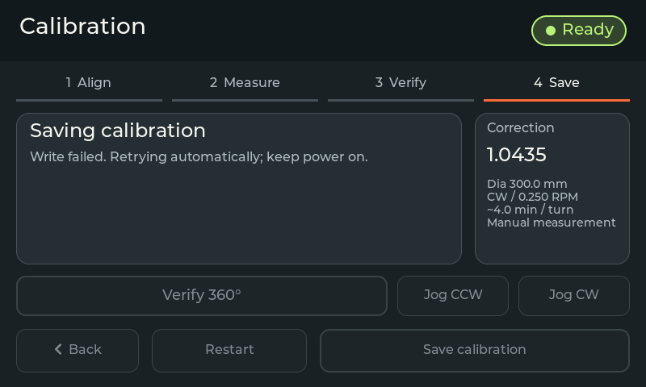
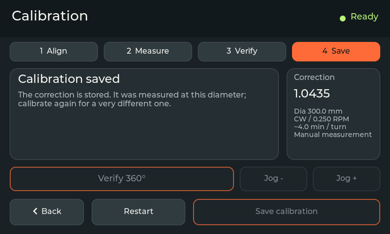

# Workpiece calibration

The calibration workflow is included in v2.1.1 firmware and simulator. These current source captures also show the v2.2.0 text/input refinements. They are actual 800 × 480 LVGL 9.6 simulator captures, using the V5 dark graphite/orange design. The simulator validates interaction and state transitions; the operator must measure the real workpiece.

> [!NOTE]
> Calibration has four stages: **Align**, **Measure**, **Verify**, **Save**. Four progress indicators on the page track them.

## Align

1. **Open** <kbd>Settings</kbd> › <kbd>Calibration</kbd>.
2. **Set** the outside diameter directly on this page.
3. **Match** the drive's microstep switches to Motor Config beforehand.
4. **Jog** with hold-to-run <kbd>Jog -</kbd> / <kbd>Jog +</kbd> until a clear reference mark is aligned.
5. **Select** <kbd>Move 360°</kbd>.

The default test speed is 0.25 RPM, capped by the configured maximum. One revolution takes about four minutes at 0.25 RPM.

<table>
<tr>
<td> Align and set diameter</td>
<td> Move 360° in progress</td>
</tr>
</table>

> [!WARNING]
> Navigation does not initiate motion. Pedal starts and unrelated program/mode requests are inhibited while calibration is open. Leaving Calibration restores the panel pot and pedal.

> [!CAUTION]
> Normal software <kbd>Stop</kbd> remains visible. Use the physical E-STOP switch when required.

## Measure

1. **Wait** for a completed revolution.
2. **Measure** the total actual rotation, including overshoot.
3. **Tap** the angle field and enter the measurement.
4. **Select** <kbd>Apply measurement</kbd>.

Both decimal point and comma are accepted. Values must be finite and between 0.5 and 720 degrees; trailing text is rejected.

The draft correction is `previous factor × 360 / measured angle`. A result outside 0.5–1.5 is rejected with an explanation rather than silently limited. Check diameter, gearing, roller contact and the measurement before restarting. The saved correction is the starting value; Restart does not reset it to 1.0.

## Verify

1. **Mark** the current start position.
2. **Select** <kbd>Verify 360°</kbd> in the same direction.
3. **Enter** the actual angle after this second completed move.

Save becomes available only within **360 ± 0.5 degrees**. A failed result can be verified again or restarted for a new correction.

<table>
<tr>
<td> Ready to verify</td>
<td> Outside tolerance</td>
<td> Verification passed</td>
</tr>
</table>

The controller must report exactly one additional completed Step move and idle state before accepting either measurement. Stop, a fault, stale controller status, timeout or changed direction/microstep context invalidate an interrupted move. Save also checks diameter and the active factor. A Stop transition to idle cannot count as a completed revolution.

## Save

1. **Select** <kbd>Save calibration</kbd> after a passing verification.
2. **Wait** for <kbd>Calibration saved</kbd>, which requires the matching storage receipt.

<table>
<tr>
<td> Storage retry</td>
<td> Confirmed save</td>
</tr>
</table>

> [!IMPORTANT]
> Until you save, the correction is a runtime draft, excluded from saved settings and other autosaves. Leaving or restarting discards it once the controller is idle. Existing presets and stored settings retain their format. A saved calibration also stores its diameter.

> [!WARNING]
> Failed writes retry automatically. Keep power on. Back and Restart are disabled while saving. Stop still requests a normal stop without losing the pending save confirmation.

The page has no scrolling: four progress indicators, one instruction/input stage, a context card and fixed controls. The numeric editor uses the full screen. Disabled controls are dimmed.

> [!NOTE]
> Estimated progress is derived from motor pulses and is not a physical angle sensor. Roller slip, backlash and measurement error still require real-world assessment.

## Check

| Symptom | Meaning | Action |
|---|---|---|
| Measurement rejected | Value is not finite, outside 0.5–720 degrees, or has trailing text | Re-enter a plain number |
| Correction rejected with explanation | Result is outside 0.5–1.5 | Check diameter, gearing, roller contact and the measurement, then restart |
| Save not available | Verified angle is outside 360 ± 0.5 degrees | Verify again, or restart for a new correction |
| Interrupted move not accepted | Stop, fault, stale status, timeout or changed direction/microstep context | Repeat the move |
| Back and Restart disabled | Save in progress | Wait for <kbd>Calibration saved</kbd>, keep power on |

## Regression evidence

492 native/control/speed/storage/safety cases include the actual calibration module, session policy and production dispatcher. Cases cover interrupted/rejected moves, timeout and clock wrap, context changes, strict parsing, correction bounds and draft isolation. The actual LVGL self-test additionally checks interrupted motion, failed verification, successful verification, failed storage/retry and Stop during saving. The layout audit reports zero failures. Firmware builds pass for release, debug and mirror; the functional pre-release build was flash-verified. On 2026-10-05 the owner confirmed the assembled functions work, including the pedal/ADS1115 (detected at 0x48; owner-verified on hardware with the master pedal fix). Quantitative calibration and stop-time results were not supplied. On 2026-11-04 the owner reported v2.3.0 tested on the assembled machine; no measured calibration accuracy was supplied.
