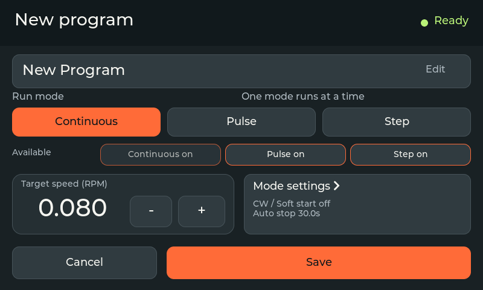
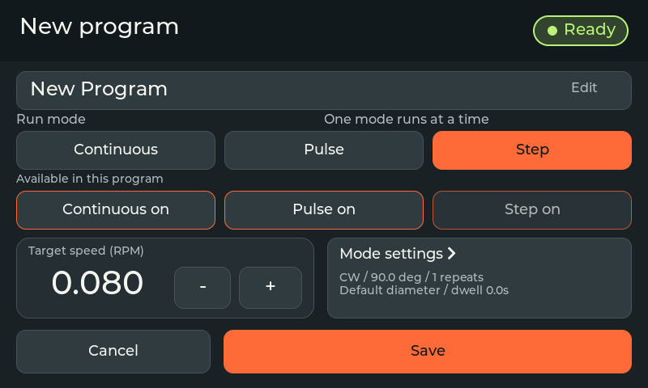
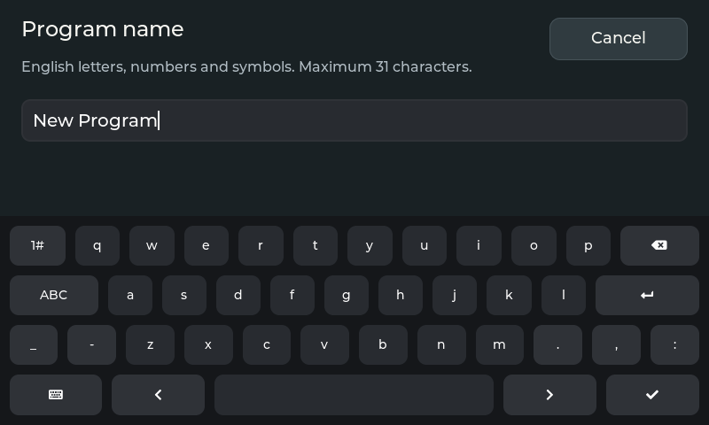
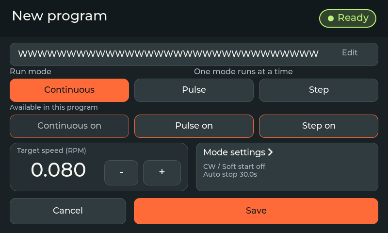
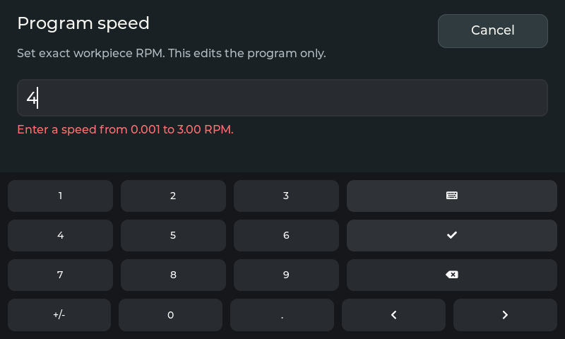
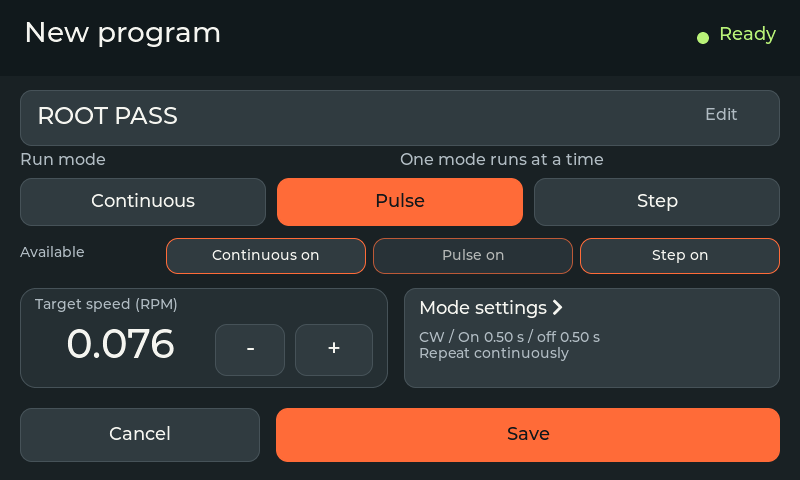
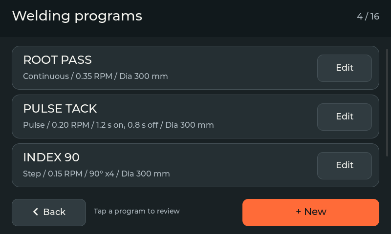

# Program editor

The editor uses the existing V5 palette at 800×480, with no page scrolling. These captures come from the actual LVGL 9.6 simulator, not design mockups. The core editor is included in v2.1.1; these current source captures also show the v2.2.0 text/input refinements. Historical downloads retain their original appearance.

## Create or edit

1. **Open** <kbd>Programs</kbd> › <kbd>+ New</kbd>, or edit an existing slot with <kbd>Edit</kbd>.
2. **Name** it: the top field opens the name keyboard.
3. **Pick** the mode with <kbd>Run mode</kbd>: Continuous, Pulse or Step. Selecting the same mode again leaves it selected.
4. **Choose** other modes with <kbd>Available</kbd>. They are offered for this preset. The active run mode is always included.

<table>
<tr>
<td> New program</td>
<td> Step selected</td>
</tr>
</table>

## Name and exact speed

Tap the name, edit it, and use the keyboard's confirm key or the visible <kbd>Cancel</kbd> button.

| Rule | Value |
|---|---|
| Whitespace | Leading/trailing spaces are trimmed |
| Empty confirmed name | Becomes `Untitled` |
| New editor names | Up to 31 printable ASCII characters supported by the display font |
| Invalid or oversized entry | Shows an error instead of truncating |
| Legacy UTF-8 names | Remain intact in storage, with the font's glyph limitations |
| Long ASCII names | Use a smaller summary font |

<table>
<tr>
<td> Name keyboard</td>
<td> Longest wide ASCII name</td>
</tr>
</table>

Tap the RPM value to enter exact speed. Dot and comma decimal separators are accepted. The whole entry must be numeric and within `MIN_RPM` and the maximum for this program's diameter. Invalid input leaves the editor open and preserves the draft.

| Setting | Value |
|---|---|
| Summary and mode-settings +/− step below 0.1 RPM | **0.001 RPM** |
| Summary and mode-settings +/− step otherwise | **0.01 RPM** |
| Display precision | Follows the same rule |
| Maximum | Lower of the Max RPM setting and the per-diameter cap from `MAX_STEP_HZ` and `MOTOR_RPM_LIMIT` |

A larger diameter in the Step editor lowers RPM visibly.

> [!WARNING]
> A saved program above the cap is blocked at start. If a start is blocked after you confirm it, <kbd>PROGRAM BLOCKED</kbd> shows the reason and returns to the list.

## Mode settings and saving

1. **Open** <kbd>Mode settings</kbd> for the selected mode's direction/timing controls.
2. **Save** there to return updated values to the draft. <kbd>Cancel</kbd> retains the previous draft values. Neither starts motion or writes the program itself.
3. **Save** in the main editor to add/replace the preset and queue its debounced NVS save.
4. **Wait** for the matching successful storage receipt. The button shows <kbd>Saving...</kbd> or <kbd>Save failed, retrying</kbd>, then the editor returns to Programs.

> [!IMPORTANT]
> Edits and Cancel stay locked while the write is pending.

Before saving, <kbd>Cancel</kbd> discards the editor draft. Existing slots additionally offer <kbd>Delete</kbd> with confirmation.

> [!NOTE]
> The list remains limited to 16 programs.

<table>
<tr>
<td> Pulse draft</td>
<td> Saved program list</td>
</tr>
</table>

## Validation

`--self-test` covers the actual editing flow, all three low-speed sub-editors, numeric and UTF-8 limits, repeated mode selection, availability, save/cancel and keyboard cleanup. `--program-preview <directory>` runs the same regression and exports these seven states. `--audit-layout` checks registered screens, including the editor footer/mode positions. Real touch and motion are not exercised by these PC checks.
