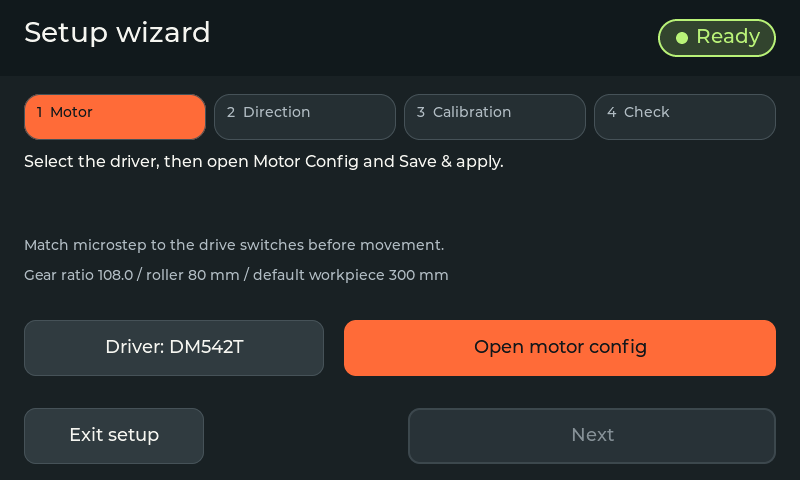
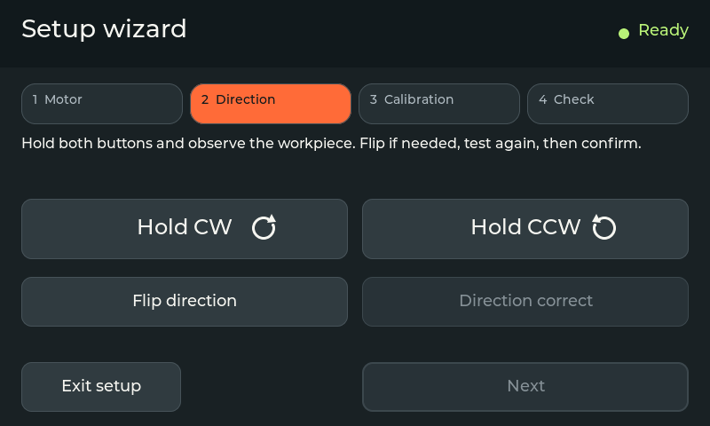
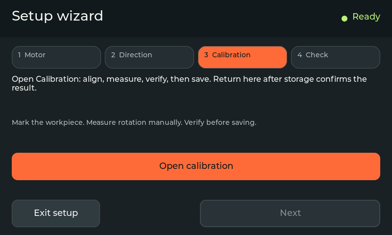
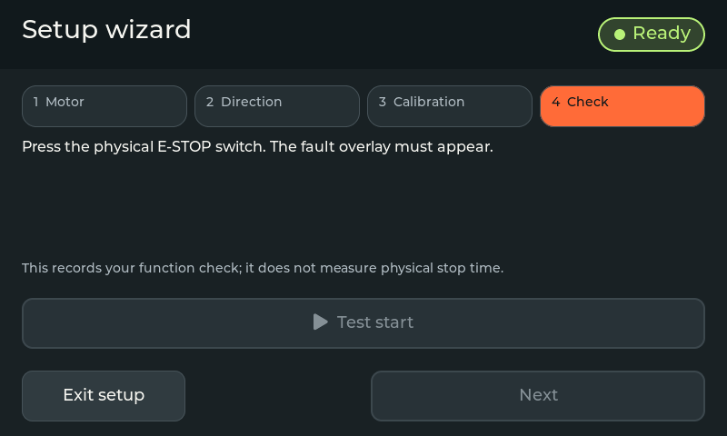
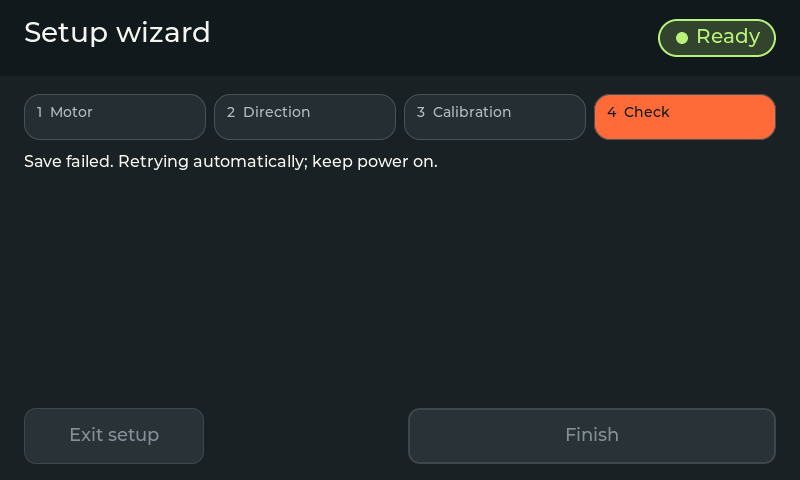
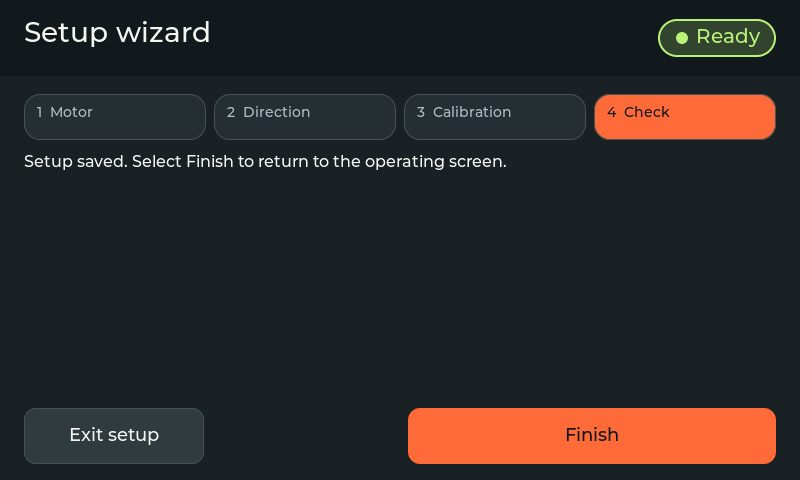

# Setup Wizard

Included in v2.1.1 firmware and simulator. Historical v2.1.0 downloads do not include it. The existing V5 operating-screen design is retained.

New installations open the wizard after boot. Existing valid settings without `setup_completed` migrate as configured and retain all settings/presets. Open <kbd>Settings</kbd> › <kbd>Setup wizard</kbd> to run it voluntarily. An interrupted, incomplete new setup is offered again on restart.

> [!NOTE]
> Exiting (<kbd>Exit setup</kbd>) stops any requested motion and keeps settings already saved. It does not reset the machine configuration.

The wizard has four checks: Motor, Direction, Calibration, Function check.

## 1. Motor

1. **Select** Standard or DM542T timing.
2. **Select** <kbd>Open motor config</kbd>.
3. **Match** the microstep setting to the physical drive switches.
4. **Set** acceleration and maximum RPM.
5. **Press** <kbd>Save & apply</kbd>.
6. **Continue** only after the settings are applied and saved.

The page shows the current gear ratio, roller diameter and default workpiece diameter. Gear ratio and roller diameter are set in Motor Config (defaults 108 and 80 mm).

## 2. Direction

1. **Hold** <kbd>Hold CW</kbd>, then <kbd>Hold CCW</kbd>, separately. Observe the actual workpiece.
2. **Flip** if needed: select <kbd>Flip direction</kbd>, wait for the configuration save, and test both directions again.
3. **Confirm** by selecting <kbd>Direction correct</kbd> while idle.

Releasing either button stops jog. Missing hold renewal also stops it. Test speed is 0.1 RPM, capped by configured maximum.

## 3. Calibration

Open [guided Calibration](CALIBRATION_WORKFLOW.md).

1. **Set** diameter on that page and align the mark.
2. **Select** <kbd>Move 360°</kbd> explicitly, measure, then apply.
3. **Select** <kbd>Verify 360°</kbd> and measure again.
4. **Save** only after verification passes.
5. **Return** after <kbd>Calibration saved</kbd> confirms storage.

Navigation never initiates a calibration movement.

## 4. Function check

1. **Press** the physical E-STOP switch. The red fault overlay blocks operation and reads <kbd>Release the E-STOP button.</kbd>
2. **Release** the switch and inspect the machine. The banner turns amber and reads <kbd>READY TO RESET</kbd>.
3. **Select** <kbd>RESET TO IDLE</kbd>. Reset does not start movement.
4. **Select** <kbd>Test start</kbd> explicitly and observe rotation.
5. **Select** <kbd>Stop</kbd>.
6. **Confirm** that the workpiece physically stops before continuing.
7. **Press** <kbd>Next</kbd> to confirm the physical function check.

> [!WARNING]
> The screen Stop is a normal software stop. It is not a substitute for the physical E-STOP.

> [!NOTE]
> The wizard observes input and controller-state sequences; **Next is your confirmation of the physical function check**. It does not measure electrical/mechanical stop time or certify the machine. Pedal starts are inhibited throughout commissioning.

## Completion and failed saves

Completion is confirmed only when its settings-save generation is committed. A failed save displays the error and retries automatically; <kbd>Finish</kbd> remains disabled until persistence succeeds.

> [!IMPORTANT]
> Keep power on during retry.

<table>
<tr>
<td> Failed save</td>
<td> Setup saved</td>
</tr>
</table>

No automatic motion starts on completion. Reopening the wizard begins a fresh set of checks without clearing existing motor settings or programs.
