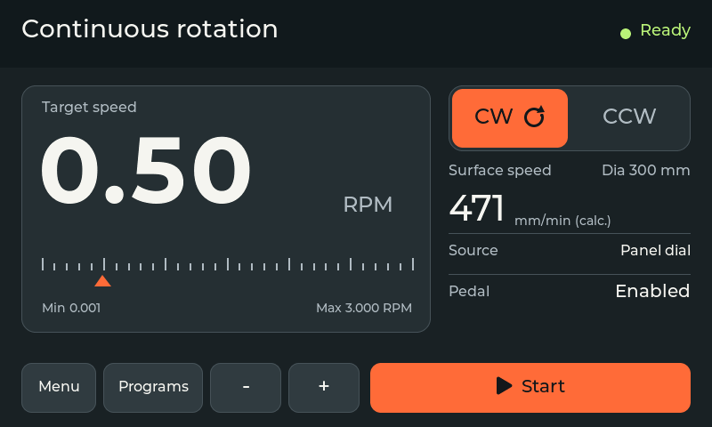

# DIY Welding Positioner Controller

**ESP32-P4 / C6 GUITION JC4880P443C** | Open-source firmware for TIG/MIG welding rotators



Actual LVGL simulator capture with example data. Main RPM +/− controls operate while idle; physical direction-switch priority and fault gates remain effective.

## Start here

| I want to... | Go to |
|--------------|-------|
| Build, flash and do the first run | [[Getting Started]] |
| Wire the driver, pot, E-STOP and pedal | [[Hardware Setup]] |
| Fix a problem | [[Troubleshooting]] |
| Understand the firmware design | [[Architecture]] |
| See what is done and what is next | [[Roadmap]] |

## Current Status: v2.3.1 - Operator feedback and test fixes

> [!NOTE]
> Release **v2.3.1** is the current firmware identifier (**`FW_VERSION`**). It explains blocked program starts and REBOOT, keeps the Step keypad open on an invalid entry, stops Jog changing the manual direction and names every fault on the overlay. The owner reported them working on the assembled machine on 2026-11-04.

v2.3.0 adds UI, touch and pot supervision, visible crash and storage faults, per-diameter RPM limits and settings for roller diameter and gear ratio. The owner reported it tested on the assembled machine on 2026-11-04, including TIG HF.

Earlier releases include v2.0.8 version alignment and v2.0.7 dark/light mode. See the repository changelog for history.

## Current release and UI

| Link | Use |
|------|-----|
| [Download v2.3.1](https://github.com/catorendal-a11y/DIY-Welding-Positioner-ESP32-P4/releases/tag/v2.3.1) | Prebuilt firmware |
| [Flashing instructions](https://github.com/catorendal-a11y/DIY-Welding-Positioner-ESP32-P4/blob/master/docs/releases/FLASHING.md) | How to flash it |
| [Validation and improvements](https://github.com/catorendal-a11y/DIY-Welding-Positioner-ESP32-P4/blob/master/docs/FASTACCELSTEPPER_1_4_REAUDIT.md) | Re-audit notes |

> [!NOTE]
> Latest update verified in native tests and simulator. Physical safety checks remain bench work.

Implemented features:

- Motor rotation with live RPM adjustment (potentiometer + foot pedal; V5 main screen has idle RPM +/− controls)
- 4 rotation modes (Continuous, Jog, Pulse, Step) and a start countdown
- E-STOP input disables ENA and latches a fault; explicit guarded UI reset
- Task, UI, touch and pot supervision, with visible crash and storage faults
- 16 program preset save/load (NVS JSON blobs; legacy LittleFS migration on first boot if needed)
- 23 registered LVGL root screens (`ScreenId`) plus E-STOP overlay; settings, diagnostics, pedal settings, system info, guided calibration and Setup Wizard
- Portable Windows simulator: extract all files and open Start Simulator.cmd; no hardware or development tools needed
- USB-C live mirror for the real device UI, plus simulator screenshot export for all screens
- Direction switch (GPIO29), foot pedal support
- 8 accent color themes, dark or light UI mode (Display Appearance), brightness control and an idle screen saver with preview
- TIG HF welding works when electronics are inside one grounded metal enclosure (see [[Hardware Setup]])

## Quick Links

| Page | Description |
|------|-------------|
| [[Getting Started]] | Build, flash, and first run |
| [[Architecture]] | FreeRTOS dual-core design, state machine, thread safety |
| [[Hardware Setup]] | Wiring diagram, driver config, BOM |
| [[Troubleshooting]] | Common issues and solutions |
| [[Roadmap]] | Completed features and future plans |

## Project Overview

Open-source welding positioner controller for rotary welding tables, pipe welding rotators, and automated fabrication systems. Controls a NEMA 23 stepper motor through a **1:108** default drivetrain (NMRV030 + spur) with precise RPM control (**0.001-3.0 RPM** workpiece absolute limits in `config.h`; Motor Config stores a lower **max RPM** ceiling in NVS if desired).

### Key Specs

| Parameter | Value |
|-----------|-------|
| MCU | ESP32-P4 (360MHz, dual-core RISC-V) |
| Display | GUITION JC4880P443C, 800x480 landscape, MIPI-DSI ST7701S |
| Touch | GT911 capacitive |
| UI Framework | LVGL 9.6.0 |
| Motor Driver | FastAccelStepper 1.4.0 (upstream `f24a659`) (RMT hardware pulses) |
| Gear Ratio | **1:108** default (60 x 72/40, NMRV030 + spur), set in Motor Config |
| Microstepping | 1/4, 1/8, 1/16, 1/32 (selectable) |
| RPM Range | 0.001-3.0 RPM (`MIN_RPM`/`MAX_RPM`); UI max <= cap via Motor Config (NVS), further capped per diameter |
| Storage | NVS (`Preferences`) + ArduinoJson blobs `cfg` / `prs` (16 presets, settings); one-time LittleFS import |
| Cross-core | `std::atomic` with explicit memory ordering; single source of truth in `src/app_state.h` |

## Repository Structure

```
src/
  main.cpp              - FreeRTOS task setup
  config.h              - All hardware pins and motor parameters
  motor/                - FastAccelStepper wrapper, speed control, microstepping
  control/              - State machine, 4 rotation modes
  safety/               - E-STOP ISR + watchdog
  storage/              - NVS persistence (+ legacy LittleFS migration)
  ui/                   - LVGL screens, display init, touch, theme
  mirror/               - Optional USB-C live mirror protocol/task
docs/
  images/               - SVG wiring diagrams, UI mockups
wiki/                   - GitHub Wiki pages
```

v2.2.0 includes an [idle screen saver](https://github.com/catorendal-a11y/DIY-Welding-Positioner-ESP32-P4/blob/v2.2.0/docs/SCREEN_SAVER.md) with preview and wake-touch consumption.
